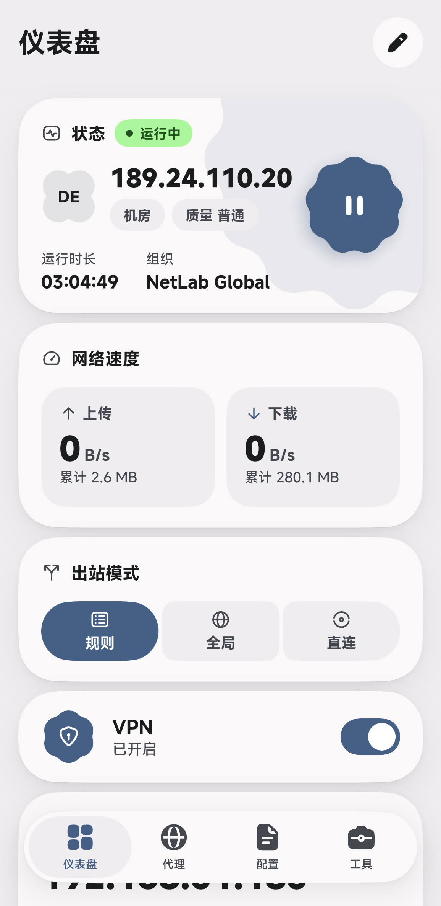
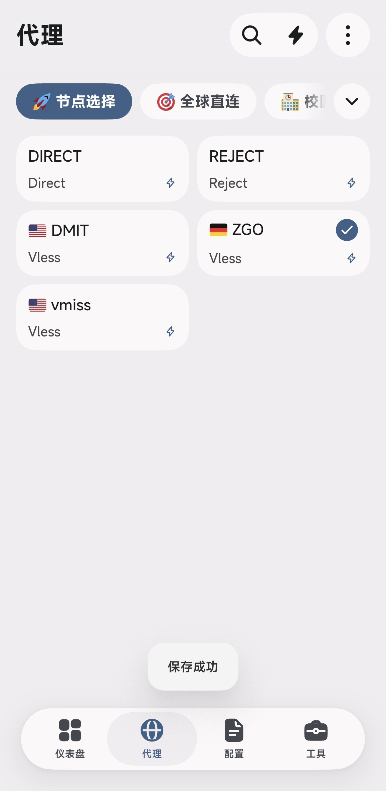
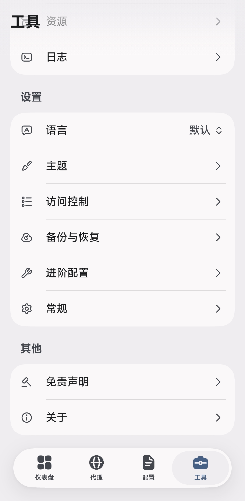
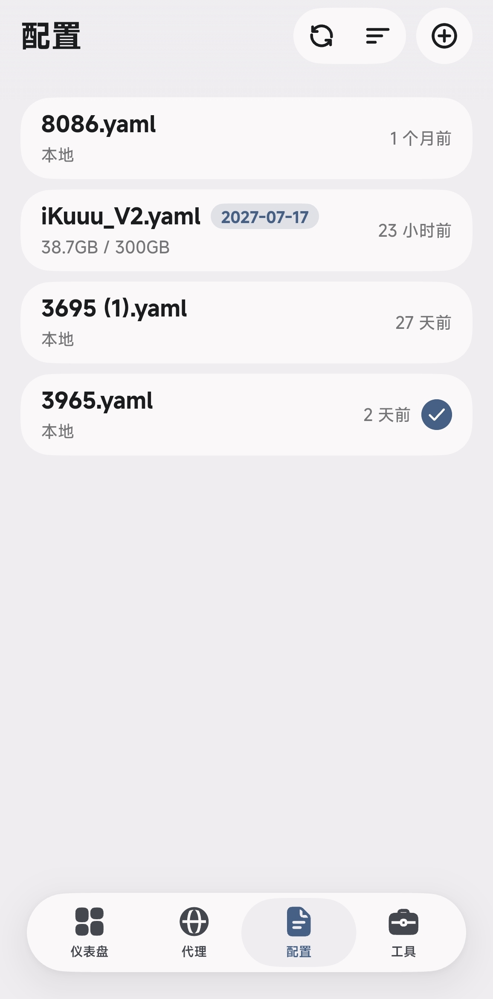

# FlClash 移动端参考基准

> 层级：L3

本文是 Slint 移动端持续视觉迭代的**外部参考基准记录**。四张参考图均来自外部应用 FlClash（Android 竖屏截图，2026-11-05 采集），仍作为布局、密度、层级与间距的对比锚点；它们**不是本仓验收证据**，不能据此宣称参考图已 100% 实现，也不能用来宣称任何像素或行为已验证。本仓当前结论只以最新整批发布回执为准。

## 1. 素材清单

| 屏幕 | 文件（相对本文目录） | 原始尺寸 | 格式 | SHA-256 |
| --- | --- | --- | --- | --- |
| 仪表盘 | [flclash-mobile/flclash-mobile-dashboard.png](flclash-mobile/flclash-mobile-dashboard.png) | 1155 × 2367 | PNG | `b6dc2946742ed013761418df3ff6ca175dc527d2881ea4b00ed42fa61650094a` |
| 代理 | [flclash-mobile/flclash-mobile-proxies.jpg](flclash-mobile/flclash-mobile-proxies.jpg) | 1156 × 2363 | JPEG | `5de31622e2e61556ac15143cdd82bcadd32ddadf3621ab6f1624196b245fe4c9` |
| 工具 | [flclash-mobile/flclash-mobile-tools.jpg](flclash-mobile/flclash-mobile-tools.jpg) | 1156 × 2360 | JPEG | `7bc6e64edfb3b91b8ecd0eda90113ab53a02020d757cc267b56abe526abad0fb` |
| 配置 | [flclash-mobile/flclash-mobile-profiles.jpg](flclash-mobile/flclash-mobile-profiles.jpg) | 1156 × 2342 | JPEG | `bae4f89fa28d474184f604c522fbfd7d477ceebfc0b861c6e2122859ab2fce73` |

四张图宽度一致（±1 px），说明是同一台设备、同一竖屏窗口尺寸下连续采集（高度相差 ≤25 px，属状态栏与内容裁切差异）。像素密度未知，因此本文全部尺寸按**屏宽/屏高比例**记录，实现时用 `LumenUiScale` 换算，不照抄像素值。

### 1.1 b128 时效硬门（2026-11-07）

- `scripts/quality/receipt-freshness-guard.py` 现在同时校验「发布 PNG 与最近整批 manifest 的 SHA-256 一致」以及「最近整批 metadata 的 `source_fingerprint` 与当前源码一致」。后者直接调用 `scripts/parity/visual_receipts.py --fingerprint`，与 `capture-slint-matrix.sh` 写入 metadata 的算法是同一个函数，不再依赖人工比较截图 mtime。
- 上述 b127/b128 的指纹与「197 张 PNG 已过期」是**当时**的时效结论，不是本文的当前状态：此后 b146～b159 已多次按身份变化整批重采，当前发布批为 `20261109T150048Z_a2c3a2924bf6_dirty_1644937`（197/197，422s），`receipt-freshness violations=0`、`screenshot-identity scanned=574 aliases=10 violations=0`。本段保留仅为记录「新鲜度由运行绑定、不由 mtime 判定」这条长效规则；任何具体指纹/批次号都以最新 manifest 与 `source_fingerprint` 为准，不得引用这里的 b127 旧值当现状。
- 用户 2026-11-07 16:28 的底栏裁图 `/tmp/codex-clipboard-6597baf4-a86f-437d-9540-b82068f3875b.png` 与 2026-11-06 两张历史裁图均已按「过时截图即时删除」规则删除；它们只用于触发问题定位，不保留为判据、不翻旧账。四张 FlClash 参考图是外部对照基准，不属于本仓截图回执，继续保留。
- 判定入口仍是 `scripts/parity/resolve_surface_evidence.py` 与 `scripts/parity/visual_receipts.py`；任何用户裁图、`/tmp` 临时放大图、诊断帧或过期整批都不得写成「当前发布回执」。新截图必须带整批 `capture-manifest.tsv`、`capture-metadata.txt`、发布目录 `source_fingerprint` 与 `binary_sha256` 四者对账。
- b128 独立只读审计的逐屏像素坐标、`S-*` / `P-*` 长效不变量与四者对账命令见 [移动端真实像素回执长效不变量](MOBILE_RECEIPT_INVARIANTS.md)；本文仍只记录外部参考基准，最新有效像素由整批重采后的 manifest 与活源码指纹裁决。

下面标注「实测」的数字来自逐像素扫描（按行中位数区分白卡与页面底色，误差 ±2 px），标注「目测」的仍是主观估计。

## 2. 全局视觉语言

- **页面底色**：浅暖灰，实测约 `#F0EEF1`；卡片为纯白 `#FFFFFF`，靠色差分层，不靠描边。**该基准已回灌到公共体系**：`LumenTheme.zinc-*` 在四种皮肤里统一为「页面→卡片逐层抬升」——旧 light/forest 纸梯方向相反，`SurfaceCard`（`zinc-3`）反而比页面暗 10 亮度级，卡片沉进页面；现 light 卡 255.0 / 页 240.0（+15.0）、forest +18.3，与 dark 的 +21.5、amoled 的 +16.0 同向。`scripts/quality/slint-surface-ladder-guard.py` 钉死这条不变量。
- **强调色**：石板蓝，实测约 `#465F85`（激活胶囊、选中圆徽、开关、状态卡图标块共用同一主色）。
- **状态色**：运行中徽章为浅绿实心胶囊，实测约 `#ACF69B`，内部文字与圆点用深色。
- **文字层级**：正文/标题深色约 `#1B1C1E`；次级文字约 `#757577`～`#44474D`；层级主要靠字号与字重拉开，不靠彩色。
- **圆角与阴影**：卡片与胶囊圆角明显（目测 16–20 px @1156 宽），浮层（底部导航、Toast、动作簇）带柔和投影。
- **安全边距（实测）**：页面左右各约 50 px @1156 宽，即 4.3% 屏宽；卡片都在这条边距内对齐。
- **卡片间距（实测）**：四屏一致，纵向间距 24–25 px，即 1.0% 屏高；浮动底栏与最后一张卡的间距同为 24–25 px。
- **卡片圆角（实测，按白色卡片左上角逐行扫描）**：卡片上沿起笔即内缩 18 px，圆角曲线在 52 px 高度内收敛到卡边（约 17.6dp），是比纯圆更平缓的连续圆角；按 400 宽折算后我方手机卡半径取 **20u**（`LumenTheme.radius-mobile-card`），比原先节点卡的 12u、配置卡的 16u 更接近参考。
- **组标题留白（实测）**：卡片 → 标题 81 px，标题 → 卡 51 px（折算 27.4dp / 17.3dp），总槽 177 px（折算 60dp）；标题墨迹 45–49 px（折算 15.6–17.0dp）。
- **浮动底栏（实测，按分色剔除投影）**：底栏**本体** 1025 × 186 px（≈346 × **63dp**，7.9% 屏高），下沿直接落在系统手势条上，不自带底部留白；其内的高亮激活胶囊 267 × 163 px（≈**90 × 55dp**，全圆胶囊 radius=h/2），本体上下各留 4dp。四个 tab 等分。
  - **b161 同屏密度对照（求同存异，不改几何）**：把仪表盘图按 1155px/393dp = 2.939 折算，参考手机首屏（≈805dp 高）在浮动底栏之前只露出**状态卡 + 网络速度卡 + 出站模式卡 + VPN 卡**（四张，卡片带实测约 69/81/63dp 高、彼此 8.5dp 间距）；本仓已发布 400×800 竖屏帧在同类底栏之前露出**状态卡 + 网络速度卡 + 出站模式卡 + 系统代理卡 + 内网 IP/配置双联卡 + 服务状态/内存双联卡的起始**（六段内容），即同等窗口高度下多出约两张卡的信息密度。两者不互相判违规：参考是「按内容排布的大卡流」，本仓走 `dense` 卡片网格并已由判定器按页面形态给 12% 上限；差距来自产品密度裁决而非留白失控，故本条只登记对照、不据此收窄任何 token。底栏带本体的 7.9%（参考，不含投影与手势条）与本仓 84u/800u = 10.5%（含 `dock-top-air` 8u + 胶囊 64u + `bottom-bar-inset` 12u 三段已裁决的保留带）**不是同一测量盒**，不得直接相减后当成超标。
  - 早前一版本文把底栏记成 237 px 高 / 胶囊 212 × 186 px，那是按亮度带扫描的结果，把约 51px 的下投影与侧投影算进了本体；现按 `#FAF8F9` 本体与 `#EFEDF0` 胶囊分色重测，以本节为准，`LumenTheme.bottom-bar-*` 的 token 同步按此落地。
  - **底栏填充（实测与长效标准）**：浮动胶囊本体采用 contract alpha 0x99（60%）的玻璃 veil（`LumenTheme.floating-surface`，Light `#FFFFFF99` / Forest `#FFFFFF99` / Dark `#333D4899` / AMOLED `#303A4499`，描边读 `LumenTheme.dock-rim-color`）。与参考对应关系：参考胶囊本体实测 (251,248,249)、页底 (241,238,239)，白色 60% veil 合成 ≈ (249,250,251)，落在参考 ±3 内；深色皮肤同 alpha 用冷灰 tint，合成后仍高于卡片层。胶囊绝不采用 100% 不透明的实心硬块（实心块在视觉上是遮盖条而非悬浮条），同时胶囊外侧的透出区域为透明 strip 并由 `MobileDockPageGround` 保留纯净页面底色 `zinc-0`，内容在滚动到末尾时由保留带挡在胶囊背后，保证悬浮透气与文字高可读性兼得。
- **行/卡高度（实测）**：工具列表单行 166–168 px（7.0% 屏高 = 14.4% 屏宽）；配置卡 192 px（8.2% 屏高，四张等高）；代理节点卡 198 px（8.4% 屏高 = 17.1% 屏宽）。
- **选中态只有一个颜色（实测）**：参考的选中胶囊、选中圆徽与所有强调面共用同一石板蓝 `#465F85`，**没有第二种「选中色」**。我方 `LumenTheme.selection` 恰恰是第二套强调色（夜色写死 `#2563EB`），既不看皮肤也不看用户自选强调色：`proxies-mobile-dark` 旧回执里选中胶囊是蓝，而同一帧的底栏激活胶囊、出站模式胶囊全是青。现 `selection: root.accent`，一个属性同时供给组胶囊、节点圆徽、配置对勾与开关；新回执 `proxies-mobile-light` 实测选中胶囊 (1,104,136) = `#016888`，与强调色逐通道相同。
- **行尾留白（实测）**：参考 chevron 墨迹右沿距卡边 24u（VPN 开关墨迹 21u），我方旧值 19u，读起来就是贴边。`LumenTheme.row-trailing-inset` 因此取 **4u**——chevron 的 18u 盒子自带约 7u 右内边距，行只需再让出一步间距。新回执 `settings-mobile-light` 实测 chevron 墨迹 x 356–361、卡右边 384 → 内缩 23u。
- **运行/暂停圆盘只有一个字形（实测）**：参考圆盘内只有暂停/播放矢量，**没有文字标签**；我方曾把「暂停/启动」两字塞进 56–64u 的花边圆盘，字墨永远压在竖条上（用户截图里就是被自己按钮切断的半截字）。现在这个词只活在 `accessible-label`，矢量按参考比例派生：竖条宽 = 盘径 6.5%、两轴中心间距 = 15%、墨高 = 32%。注意 `Path` 的 `stroke-width` 是**元件单位而非 viewbox 单位**，写死 6u/7u 会让小盘把两条竖条并成一坨白块，故必须由盘径推导。产品侧已把「圆盘」换成**吉祥物圆盘**：控制按钮不再是独立圆盘，而是叠在青蛙身上的强调色徽记，字形由徽记直径推导（`stroke-width: scrim.width * 0.10`），盘内依旧没有文字标签。
- **吉祥物只有一个尺寸真源（实测，本批整改）**：`MusicFrogHero` 此前有 `button-size` 与 `hero-scale` 两个入口，手机盘径 = 56u × 2.35 = 131.6u，比参考圆盘（≈88dp @400 宽）大近一半，且圆盘被布局顶出卡片右边界：旧回执实测圆盘右沿 x=395、卡右边 x=381，青蛙整只骑在卡片外沿上。现只留 `disc-size` 一个 typed 真源（手机 96u / 桌面 128u），旧两个入口已删除；手机状态卡另把「出口 IP 可用」从状态行下移到 chip 行——状态行（状态 + 徽章 + 出口 IP 提示）+ 吉祥物列的最小宽度比卡片内容盒还宽，布局因此把圆盘整只推出卡片，这是「青蛙出圈」在手机上的真凶，不是遮罩问题；
- **底栏下沿不再漏内容、上沿不再切卡（实测）**：胶囊与窗口底之间那 12u (`bottom-bar-inset`) 曾是滚动内容直接穿过的通道，一张卡的强调色横条会从胶囊底下露出一截（旧回执 `overview-mobile-light` 实测 x 283–330 / y 788–790，即用户问的「底部奇怪的空隙」）。第一百二十二批把这条从「靠 padding 补救」升级为「结构上不可能」：底栏带是 dock 拥有的唯一区域，滚动视口减去整个带高，所以内容不可能进入胶囊背后、也不可能从胶囊下方的通道重新露出；`AppBottomBar` 的 strip 依旧透明，胶囊作为唯一浮动几何是玻璃 veil（绝非实心板），`DockPlacement.floating/reserved` 二选一旧规则已删除。第一百二十四批进一步把 `LumenTheme.dock-top-air = space-mobile-card-gap`（8u）并入 `bottom-bar-band-height = dock-top-air + bottom-bar-height + bottom-bar-inset`（84u）：胶囊在带内下移 8u、窗口绝对位置不变，滚动视口止于带上沿 y716，y716–723 只剩页面底色与卡片自身投影。最新整批复测 400×800：胶囊描边首行仍 y724、本体到 y787、下沿留白 12u、胶囊盒 x20–380（360u 上限居中，描边与投影外溢到 x16–384），胶囊两侧通道（x0–18/x381–399，y724–788）与胶囊下方通道内的卡片层像素均为 0；10 张竖屏帧 y716–723 的卡片层像素由旧批 6475 降为 0。用户 2026-11-06 22:08 的 877×211 裁图是 b124 之前的旧帧，已按新鲜度纪律淘汰，不再作为判据。参考四屏既没有「悬浮覆盖」分支，也没有两种形态，只有一种：胶囊悬浮、内容止步于带上沿。
- **底栏到最后一张卡（实测）**：参考这一间距与卡间距同为 24–25 px（≈8.5u）。我方滚动容器曾在底栏几何之外再加 48u「呼吸位」，等于每页滚到底都留一条约五倍卡间距的空带（即用户问的「底部奇怪的空隙」）。现在空气带由 dock 自己拥有（`dock-top-air` = 8u），滚动视口止于带上沿 y716，列表 `padding-bottom` 为 0u，页面不再付第二次卡间距；带高只由承载页头与滚动视口的列减一次，`ScrollView` 只 stretch（第一百二十四批修掉工具页在 ScrollView 上第二次扣带高、被 52u 页头再顶下去的缺陷）。**像素结论**：台架 `scroll` 列（`INFILTRATOR_SCROLL=end`）在本批发布回执实测 `settings-mobile-end-dark` 末卡本体下沿 y716、`overview-mobile-end-dark` 末个内容（「调整卡片顺序」动作钮）下沿 y715 → 与带上沿间距 8–9u，与参考折算 8.5u 同值；y716–723 是页面底色与卡片自身投影，不再是卡片层像素。底栏本体 y724–787（64u + 1u 描边），下沿到窗口底 12u。
- **卡片内行的悬停不画描边（实测）**：`SettingRow` 的 hovered 态原先同时给 `zinc-2` 底与 `hairline-glow` 描边，于是一张卡里凭空多出一个圆角框，框的上下沿又与相邻接缝叠成双线——即用户问的「奇怪的中间框框」与「按钮之间的怪线」。规则收口为：**卡片内的行只用底色回答悬停，边只归卡片**；独立控件（侧栏胶囊、动作胶囊）保留发丝描边，因为那里的边是真的。
- **浅色竖屏的分隔线与底栏（实测，本批新增回执）**：`settings-mobile-light` 分隔线 (213,216,218) 落在卡片 (244,244,245) 上，色差 31/255 = 12.2%，与参考的 31/255 = 12.4% 同值；接缝 x 76–371（卡 16–384）与夜色竖屏逐像素同列；底栏内部逐行中位数恒为 (244,244,245)，浅色皮肤同样没有鬼影。
- **图标**：参考图混用两类——线性描边图标（放大镜、闪电、竖三点、刷新、排序、加号、铅笔、盾牌、齿轮、扳手、云、语言气泡、终端、信息）与 emoji（🚀 🎯 🏙 及国旗）。本仓跨表面设计资源强制标准只允许 canonical Lucide 语义图标和已登记的全彩国旗资产，**emoji 是明确不可引入项**；国旗走本仓国旗资产，其余图标必须映射到 `infiltrator_contract::design_resources` 的语义集合。
- **字号对照（实测，参考 @2.96 折算 dp，我方竖屏 @1x 即 dp）**：参考「工具」大标题墨迹 46×22dp，我方 display 角色（22px/600）墨迹 42×20dp；参考行标签「日志」墨迹 25.3×15.5dp（≈16dp em），我方 body 角色（15px/400）墨迹 27×14dp；参考笔画中位宽 5.0px ≈ 1.7dp，我方 2.0dp。两侧字号与字重在测量噪声内一致，**没有**证据支持「我方字号偏小 / 字重偏弱」的改动；105% 缩放帧与 100% 帧的可测差异同样为零（实心笔画中位宽恒 2.0px，AA/实心比 1.493 vs 1.662），所以「发虚」不归因于分数号取整，也不归因于宿主缩放（本机 niri `eDP-1` 为整数 `scale 2`）。family 分歧此后已由跨表面设计资源强制标准 §2.1 裁决：一次 `TextRole` 请求解析为单个 `TypefaceSpec`，CJK 角色按语义分别绑到 HarmonyOS Sans SC 的 400/500/600 三张独立物理面，Inter 三面仍是 `FontFamilyToken::Sans` 的完整库存供 typed `Sans` 角色使用；不再把该分歧写成「未决」，也不得把「当前角色未引用 Inter」写成删除三面的理由。
- **字重红线**：参考图大标题与关键数值的字重视觉上超过本仓允许的最重物理面（600）。实现时用 600 档物理面 + 更大字号/更小字距/更纯黑的颜色近似层级，不合成假粗，不引入 700。

## 3. 逐屏拆解

### 3.1 仪表盘



**标题与动作簇**

- 左上超大重字标题「仪表盘」，左对齐于页面安全边距（左侧留白约 4.4% 屏宽）。
- 右上角一枚圆形白底按钮，内含铅笔描边图标，是本页唯一的页面级动作。

**主体结构（纵向单列，4 张白卡）**

1. **状态卡**：首行「状态」标签 + 绿色胶囊徽章「● 运行中」；中部左侧一枚浅灰圆形国旗徽章（DE），其右是大号粗体等宽数值 `189.24.110.20`；数值下方两枚浅灰圆角 chip「机房」「质量 普通」；卡片右下角一枚深石板蓝「花瓣/徽章」形图标块，内含白色暂停符，是运行/暂停主操作；底部两列事实：左「运行时长 / 03:04:49」，右「组织 / NetLab Global」，右列右对齐。
2. **网络速度卡**：标题行小图标 + 「网络速度」粗体；卡内并排两张浅灰子卡：左「↑ 上传 / `0 B/s` / 累计 2.6 MB」，右「↓ 下载 / `0 B/s` / 累计 280.1 MB」。速率数值为最大号粗体，单位小号常规，累计值为小号次级色。
3. **出站模式卡**：标题行「出站模式」+ 分叉图标；三段分段控件，激活段「规则」为深石板蓝实心胶囊（白字 + 图标），「全局」（地球图标）与「直连」（靶心图标）为浅灰底深字。
4. **VPN 卡**：左侧深色花形徽章内白色盾牌锁图标；中间两行「VPN / 已开启」；右侧蓝色开关，滑块为白色圆点。

**密度与对齐**

- 卡间距实测 24–25 px（1.0% 屏高）；卡内左右留白目测约 4% 屏宽。
- 状态卡是全页信息密度最高的一张，承载 7 个事实；其余卡片每张只承载 1–2 个事实。
- 页面最底部在浮动底栏后方仍有一张大号速率数值卡片（`175.06 MB/s` 被底栏裁切）——**参考图本身存在浮层遮挡内容的问题**，只作为反面事实记录，不作为实现目标；本仓实现用滚动内容 + 底部内边距避免遮挡。

### 3.2 代理



**标题与动作簇**

- 左上超大重字标题「代理」。
- 右侧动作簇分两件：一枚白色胶囊容器内含两个描边图标（放大镜 = 搜索、闪电 = 测速），胶囊外再放一枚圆形白底按钮内含竖三点（更多/菜单）。

**代理组选择行**

- 一行横向胶囊标签：激活组「🚀 节点选择」为深石板蓝实心白字，其余「🎯 全球直连」「🏙 校验…」（截图中被裁切）为白底深字；行尾一枚独立圆形按钮内含「⌄」下拉 chevron。
- 组标签用 emoji 做身份图标，属于参考图特性；本仓只能用语义图标或组自身 icon 语义，不引入 emoji。

**节点网格（2 列）**

- 两列等宽卡片，实测列间距 28 px（2.4% 屏宽）、行间距 24 px（1.0% 屏高）、单卡高 198 px（17.1% 屏宽），左右外边距各 50 px（4.3% 屏宽）。
- 卡片结构：第一行「国旗 emoji + 节点名（DIRECT / REJECT / DMIT / ZGO / vmiss）」，已选中节点在右上角多一枚深色圆形实心对勾徽章；第二行左侧协议文本（Direct / Reject / Vless，浅灰常规体），右侧小号闪电图标（逐节点测速入口）。
- 五张卡片分三行排布，第三行只有一张卡片（左列），右列留空——参考实现不做等高补位。
- **b161 同屏密度复核（存异，本仓已更紧）**：本仓 `compact` 档按契约 `proxy_grid_columns(Compact)=1` 用 **1 列整宽卡**（已发布 `proxies-mobile-light` 实测 x17–382 = 365u、5 张卡各 66u 高、间距 8–9u），每行多带一条延迟数值（38/46/62/75/158 ms）；参考 2 列各 ≈176dp 宽、67.3dp 高，五张卡止于 ≈357dp，到浮动底栏上沿 ≈714dp 之间是 **357dp 地面（页身的 50.0%）**。本仓同一帧最后一张卡止于 y490、底栏带上沿 y716 → 226u 地面（**31.6%**），判定器实测 `unused` **29.0%**（light）/ 29.3%（dark），远低于 `content` 形态 82% 上限。所以「手机档 1 列」不是留白失控，反而是比参照物更紧的密度裁决；两列会把同样的 5 个节点摊成 3 行且每行卡高不变，反而更早止笔、地面更大。本条只登记实测，不据此改契约列数或重采。

**临时反馈**

- 底部居中一枚白色圆角 Toast「保存成功」，位于浮动底栏上方。

### 3.3 工具



**标题与滚动缺陷**

- 该图是**滚动后的状态**：标题「工具」仍在左上，但「资源」组标题和首行内容已经滚到标题层下方并与标题重叠——参考实现的标题层没有不透明底或遮罩。这是反面基准，本仓不得照抄。

**三段分组列表**

1. **资源**：可见「资源」组标题、一行被标题遮挡的入口（仅露出图标与右侧 chevron），以及「日志」行（终端图标）。
2. **设置**：语言（气泡 A 图标，右侧值为「默认」+ 上下双 chevron 选择器）、主题（画笔）、访问控制（列表图标）、备份与恢复（云图标）、进阶配置（扳手）、常规（齿轮）。
3. **其他**：免责声明（印章图标）、关于（ⓘ 图标）。

**密度与对齐**

- 每组一个白色圆角卡容器；组标题为小号次级色文字，位于卡外。
- 卡内每行：左侧 20–24 px 线性描边图标（无彩色底衬）、单行标签、右侧「›」chevron；实测行高 166–168 px（14.4% 屏宽 = 7.0% 屏高），组卡之间留 177 px（7.5% 屏高）给组标题。
- **b161 同屏地面复核（求同，已达标）**：按 1156px/393dp = 2.941 折算，参考工具页最后一张白卡下沿 ≈2051px（697.3dp）、浮动底栏上沿 ≈2100px（713.9dp），仅剩 **49px ≈ 16.6dp 地面（页身 2.3%）**——这是三段分组列表几乎铺满一屏的 `framed` 形态。本仓已发布竖屏回执 `settings-mobile-dark` / `-light` 由判定器实测 `unused` **4.3% / 4.4%**、滚到底的 `settings-mobile-end-dark` **2.3%**，与参照物同量级，且低于 `framed` 4% 与 `content` 82% 两档上限；桌面 `settings-*` 为 9.9–10.0%（`content` 形态）。所以这一屏不是「参考更满、本仓更空」，两者都已把列表铺到接近底栏；本仓既有对照还实测分隔线内缩比例 16.3%/3.3% 与参考 15.8%/4.0% 一致、行距 56u = 800u 窗高的 7.0% 与参考每行 7.0% 屏高相等。**不改任何行高/间距 token。**

**行间分隔线（实测）**：卡 x 49–1107（宽 1058），分隔线 x 216–1065——左端内缩 167 px（15.8% 卡宽），右端内缩 42 px（4.0% 卡宽）；线色 (219,217,218) 落在卡色 (250,248,249) 上，色差 31/255（12.4%）；线厚 2 px；行距 168 px 等距。左端与标签墨迹起笔同一列（文字 x≈213），所以这条线是**从文字列起算**，不是从图标右侧起算，也从不贴卡的左右边。
- 本仓对应实现：`LumenTheme.row-divider` / `row-divider-thickness` / `row-divider-inset-start` / `row-divider-inset-end` 四个 token 是唯一真源，元件是 `base_widgets.slint` 的 `RowDivider`（钉在行底边的覆盖层）与 `ListRule`（作为布局项的发丝线），`SettingRow` 与侧栏分组、配置卡动作条都读它们；此前「运行观测」页还在行间手绘 4 条 `width: parent.width` 的满幅线，等于同一个列表长出了两种分隔线，已一并收敛到同一体系。
- 实测我方竖屏回执 `settings-mobile-dark`：线 x 76–371（卡 16–383）→ 左内缩 60u、右内缩 12u，比例 16.3% / 3.3%，与参考的 15.8% / 4.0% 一致；桌面回执 `settings-dark`：线 x 324–1131（卡 258–1149）→ 左内缩 66 / 右内缩 18，行距 56 等距，墨迹上下留白 13/13。
- 「运行观测」（`PageMeta`）页的同一条改动只有**诊断帧**可依，没有发布回执：该页不在 `capture_scenario::CarriedScenario` 的封闭集合里，采集链路因此拒绝为它写 `CAPTURE_READY`（这正是 fail-closed 设计）。诊断帧在 `.evidence/captures/slint/20261105T185358Z_9107f001fa16_dirty_3603067/metadiag-{standard,compact}-none/`，实测接缝 y 190/246/302/358（等距 56）、线 x 324–1131（卡 258–1149）、线色 (38,42,48)，与 `settings-dark` 同一条决策；要让这条结论进入回执台账，必须先由 parity 侧裁决该页的业务身份并登记 scenario，不能由表面自行造一个名字。
- 与本仓实现不同：参考图的行**没有副标题**，信息密度更低；本仓的 `SettingRow` 有 detail 副标题，这是有意保留的差异，不是缺陷。

### 3.4 配置



**标题与动作簇**

- 左上超大重字标题「配置」。
- 右侧动作簇分两件：一枚白色胶囊内含刷新（↻）与排序（≡）图标，胶囊外一枚圆形 ⊕ 按钮（添加）。

**紧凑卡片列表**

- 4 张白色圆角卡，纵向排列，实测卡高全部为 192 px（8.2% 屏高）、间距 24 px（1.0% 屏高）；带日期 chip 与配额的卡片**不额外增高**，信息塞进同一两行结构里。
- 每张卡两行：首行左侧粗体文件名（`8086.yaml` / `iKuuu_V2.yaml` / `3695 (1).yaml` / `3965.yaml`），右侧灰色相对更新时间（1 个月前 / 23 小时前 / 27 天前 / 2 天前）；次行左侧灰色副标题（本地 / `38.7GB / 300GB`）。
- 第二张卡在文件名右侧多一枚浅灰圆角日期 chip「2027-07-17」，chip 内文字用强调色。**本仓该路径现已进入像素台账**：Slint 的 demo 主机此前不发布 `subscription_quota`，chip 与配额条在 Slint 回执里从未出现过，而 Iced 与 Bevy 的 demo 主机都发布 `SubscriptionQuotaSnapshot::demo_fixture()`——三表面截的是「两个不同的产品状态」。现 Slint 同样发布该 fixture，`profiles-mobile-dark` 实测首行右侧 chip 文案「2026-10-01 · 剩余 25 天」、次行「已同步 43.24 GB / 173.47 GB」。
- 第四张卡在相对时间左侧有深色圆形实心对勾徽章，表示当前选中。
- **b161 同屏地面复核（求同，本仓略紧）**：按 1156px/393dp = 2.941 折算，参考 4 张卡止于 ≈1068px（363.1dp），到浮动底栏上沿 ≈2100px（713.9dp）之间是 **350.8dp 地面（页身 49.1%）**；`x=100` 通道实测白卡底沿 y1024 之后一路是页面底色直到底栏。本仓已发布 `profiles-mobile-dark` / `-light` 由判定器实测 `unused` **47.1% / 46.8%**（`tail` 1.4% / 0.5%，`band` 46.8–47.1%），即**同一形态、同量级且比参照物少留约 2pp 地面**。这正是 §3.1 的 `content` 形态按内容排布、止于最后一块：一刀切阈值会把参照物自己判违规，故 82% 上限按形态给定。本条只登记「两者都不欠账」，不为凑满而虚构第 5 张卡或拉伸行高。

## 4. 映射表：参考点 → 本仓实现入口 → 当前验收截图 → 差距/动作

> 「当前验收截图」列的判定基准见第 5 节：该列只登记**最新整批采集 manifest 中 `status=ok`、PNG 存在且哈希一致**的行。当前竖屏回执同时含 `dark` 与 `light` 两套皮肤（仪表盘 / 代理 / 配置 / 工具四页），浅色配色与对比度结论均有当前回执可依；不得再引用旧批次或诊断帧。

| 参考点 | 本仓实现入口 | 当前验收截图 | 差距/动作 |
| --- | --- | --- | --- |
| 大标题 + 右侧动作簇（代理：搜索/测速/更多；配置：刷新/排序/添加；仪表盘：铅笔） | `crates/infiltrator-slint/ui/components/base_widgets.slint` 的 `HeaderActionCluster`（成对动作共胶囊、单个动作自成一圆，几何只在此处定义）、`crates/infiltrator-slint/ui/pages/page_proxies.slint` 与 `crates/infiltrator-slint/ui/pages/page_profiles.slint` 的页头行、`crates/infiltrator-slint/ui/pages/home_compact_flow.slint` 的铅笔圆 | `crates/infiltrator-slint/docs/screenshots/proxies-mobile-dark.png`（胶囊 248–331 = 84u + 8u 间隔 + 独立圆 340–383 = 44u）、`crates/infiltrator-slint/docs/screenshots/profiles-mobile-dark.png`（刷新圆 288–331 + 8u + 添加圆 340–383）、`crates/infiltrator-slint/docs/screenshots/overview-mobile-dark.png`（铅笔圆 340–383，已改由 `HeaderActionCluster` 承载，不再是 36u 自绘圆） | 胶囊/圆的分层已按参考落地，且紧凑页头高度收成一个 token `LumenTheme.page-header-height`（52u）——此前同一行在仪表盘写 48u、在壳层写 52u、在代理与配置页写 54u，四个页面四种步距。**刷新已接上真实 typed 意图**：`refresh-profile(id)` 端到端早已实现（`CommandIntent::UpdateProfile`）却在任何 `.slint` 内没有调用点，现由页头按钮承载；id 只读 owner 投影的 `current-profile-id`，无当前配置时按钮禁用而不是发空命令。**排序按钮不恢复**：配置排序已由卡片自身的 `move-profile(id, up)` → `ReorderProfiles` 裁决，页头再加一个排序入口就是同一事实的第二表达 |
| 浮动底栏：四 tab + 柔和激活胶囊 | `crates/infiltrator-slint/ui/components/theme.slint` 的 `bottom-bar-height` / `bottom-bar-inset` / `bottom-bar-pill-*`（唯一几何真源，胶囊由底栏派生）与 `floating-surface`（唯一浮层填充真源），`app_chrome.slint` 的 `AppBottomBar`、`base_widgets.slint` 的 `NavButton` | 同上四张竖屏回执均含底栏与激活胶囊：实测底栏 724–787（360 × 64u）、激活胶囊 728–783（81 × 56u，上下各 4u，radius=h/2 全圆）、下沿留白 12u；底栏内部逐行中位数恒为 (20,23,27) | 几何与参考分色实测对齐（63dp 本体 / 90×55dp 全圆胶囊 / 4dp 内隙），并收敛到单一派生源；激活底色与墨色改读 `accent-soft` / `accent-active` 主题 token，与桌面侧栏同一决策，不再有 dark 专用字面量。**浮层材质确立为 contract alpha 0x99（60%）的玻璃 veil**（读 `LumenTheme.floating-surface` 与 `LumenTheme.dock-rim-color`），杜绝 100% 实心硬块遮盖；与参考对应关系：参考胶囊本体实测 (251,248,249)、页底 (241,238,239)，白色 60% veil 合成 ≈ (249,250,251)，落在参考 ±3 内；深色皮肤同 alpha 用冷灰 tint，合成后仍高于卡片层；通过底部保留带与几何闭环确保悬浮美感与防穿透兼得 |
| 仪表盘状态卡（状态徽章、IP、机房/质量 chip、运行时长/组织） | `crates/infiltrator-slint/ui/pages/home_compact_flow.slint` 的 `HomeCompactFlow` 状态卡、`crates/infiltrator-slint/ui/components/cards.slint` 的 `StatusBadge`、`crates/infiltrator-slint/ui/pages/home_widgets.slint` 的 `HomeMetaChip` | `crates/infiltrator-slint/docs/screenshots/overview-mobile-dark.png`（400×800 dark，hero 彩色像素约 x 265–396 / y 88–217；暂停矢量在右下角强调色圆徽）与 `crates/infiltrator-slint/docs/screenshots/overview-mobile-light.png`（400×800 light）；横向标准行为 `overview-light` / `overview-dark` / `overview-forest` / `overview-amoled`（1180×780，hero 彩色像素约 x 539–688 / y 122–269）；另有 `overview-mascot-{starting-dark,running-light,stopping-dark}` 三帧动效回执 | **MUSICFROG-001（本会话）**：hero 已升级为产品吉祥物——1254×1254 高细节透明主 plate 与同一 shared catalog ID 的 512×512 预采样 hero 绘制档构成唯一资产族，Slint 只消费生成的 `MascotAssets`；青蛙随 typed `MascotMotionSpec` 律动并释放音符，启动/暂停矢量叠在形象右下角。旧 440×440 参考放大派生已淘汰；因手机/桌面实际绘制盒约 132–150px，512 档避免 10× 实时降采样把眼镜、琴弦与西装纹理压成锯齿。参考图的深色花形圆盘不再由产品自绘 halo 复刻，而是让角色本身成为 hero；强调色与徽章形状（花瓣形）属皮肤决策，需在主题层裁决后统一落地。**运行时长已由 Core owner 发布真实会话时长**：全链底层缺位已打通——contract `infiltrator_contract::snapshot::CoreSessionObservation::{Unknown,Inactive,Active}` 是唯一 typed 观察，domain `CoreState` 每个会话态携带 `started_at_epoch_ms`（与会话令牌同生共死），application 的 Core owner 是唯一读墙钟方（打戳起点、读时实测时长），presentation 只读观察并用共享 `infiltrator_shared::elapsed_time::format_elapsed_ms` 格式化，表面一行代码不改。发布帧实测：手机竖屏 dark「运行时长」label 墨迹 y181–188 / 值 `03:04:49` 墨迹 y196–205、x28–78，与右列「组织」值同带（基线对齐）；桌面 dark label y245–251 / 值 y259–269、x274–324，同列对齐；值与参考图同为 `03:04:49`（回执批次 `20261107T172359Z_9107f001fa16_dirty_1376355`） |
| 仪表盘网络速度卡（上传/下载双子卡 + 累计） | `crates/infiltrator-slint/ui/pages/home_compact_flow.slint` 网络速度卡、`crates/infiltrator-slint/ui/pages/home_widgets.slint` 的 `AppCardHeader` | `crates/infiltrator-slint/docs/screenshots/overview-mobile-dark.png` | 结构一致；参考图速率主数值更大更粗，本仓用 600 档物理面近似，禁止合成假粗 |
| 仪表盘出站模式三段选择 | `crates/infiltrator-slint/ui/pages/home_compact_flow.slint` 出站模式卡、`crates/infiltrator-slint/ui/pages/home_widgets.slint` 的 `HomeRouteModePills` | `crates/infiltrator-slint/docs/screenshots/overview-mobile-dark.png` | 语义一致（规则/全局/直连）；图标需逐个映射到语义集合 |
| 仪表盘 VPN 开关卡 | `crates/infiltrator-slint/ui/pages/home_compact_flow.slint` VPN 开关卡、`crates/infiltrator-slint/ui/components/base_widgets.slint` 的 `AppPreferenceSwitch` | `crates/infiltrator-slint/docs/screenshots/overview-mobile-dark.png` | 文案与开关语义一致；TUN/系统代理能力差异必须由 owner 能力决定，不在 UI 层推导 |
| 代理组胶囊行 + 行尾下拉 chevron | `crates/infiltrator-slint/ui/components/proxy_picker.slint` 的 `ProxyGroupPillBar`、`crates/infiltrator-slint/ui/pages/page_proxies.slint` 的 `ProxyGroupPillBar` 挂载点 | `crates/infiltrator-slint/docs/screenshots/proxies-mobile-dark.png`（400×800 dark） | 参考图组图标是 emoji，本仓不可引入；组身份应来自共享快照的组语义或显式映射 |
| 代理 2 列节点网格（旗 + 名 + 协议 + 测速动作 + 选中圆徽） | `crates/infiltrator-slint/ui/pages/page_proxies.slint` 的 `node-columns`（4/3/2 列）与 `GridLayout`、`crates/infiltrator-slint/ui/components/proxy_picker.slint` 的 `ProxyNodeCard` | `crates/infiltrator-slint/docs/screenshots/proxies-mobile-dark.png` 与 `crates/infiltrator-slint/docs/screenshots/proxies-mobile-light.png`（400×800 双皮肤）；另有 `proxies-light`（1180×780） | 移动竖屏 2 列与选中圆徽已对齐。第二行已按参考改回**安静墨迹**：协议名与延迟值都不再套 `zinc-4`/15% 延迟色底，实测每张卡少两个矩形，分级只由墨色表达；未测速节点仍保留闪电图标作为测速入口（点击当前节点即发 `probed`，测速入口与 owner 延迟事实并存，不在 UI 层造第二个来源）。选中色统一为强调色（`selection: root.accent`），实测 `proxies-mobile-light` 选中胶囊 (1,104,136) |
| 工具三分组列表（资源/设置/其他）+ 右 chevron | `crates/infiltrator-slint/ui/pages/page_settings.slint` 的 `PageSettings`（资源/设置/其他）与 `PageMeta`、`crates/infiltrator-slint/ui/components/base_widgets.slint` 的 `SettingRow` + `RowDivider` + `ListRule`（内容在整行居中、分隔线钉在行底边）、`crates/infiltrator-slint/ui/components/theme.slint` 的 `row-divider*` 四 token、`crates/infiltrator-slint/ui/components/cards.slint` 的 `SectionCard`（`radius` 随视口取 `radius-mobile-card` / `radius-card`）、`crates/infiltrator-slint/ui/components/preferences.slint` 的行族 | `crates/infiltrator-slint/docs/screenshots/settings-mobile-dark.png`（分隔线 x 76–371 / 卡 16–383，线色 (38,42,48) 落在卡色 (20,23,27) 上）与 `crates/infiltrator-slint/docs/screenshots/settings-mobile-light.png`（同一 x 76–371，线色 (213,216,218) 落在卡色 (244,244,245) 上，chevron 墨迹 x 356–361）；另有 `settings-light`（1180×780）与 `settings-dark`（分隔线 x 324–1131，行距 56 等距，墨迹上下留白 13/13） | 分组语义一致；行分隔线已回到行界并**收进公共体系**：厚度、左右内缩、颜色只由 `LumenTheme.row-divider*` 决定，元件只有 `RowDivider` / `ListRule` 两个，「运行观测」页原先手绘的 4 条满幅 `parent.width` 线已删除，侧栏 3 条与配置卡动作条 1 条手绘线也改读同一 token；chevron 由 `currentColor` 补 `colorize` 后可见，并按 `row-trailing-inset`（4u）让出参考的 24u 行尾留白（实测墨迹 x 356–361 / 卡边 384 → 23u）；行悬停不再画发丝描边，只答底色，消除「卡里多出一个圆角框、框沿与接缝叠成双线」；本仓行有 detail 副标题（有意差异）；「语言」行的值选择器形态需按本仓控件体系另行设计。浅色竖屏本批起有回执：`settings-mobile-light` 线色 (213,216,218) 落在卡 (244,244,245) 上，与参考 12.4% 色差同级 |
| 配置紧凑卡（文件名 + 日期 chip + 相对更新时间 + 配额/本地 + 选中对勾） | `crates/infiltrator-slint/ui/pages/page_profiles.slint` 的 `PageConfig`、`crates/infiltrator-slint/ui/components/profile_card.slint` 的 `ProfileCardSurface`（compact 分支）、`crates/infiltrator-slint/ui/components/models.slint` 的 `ProfileCard` | `crates/infiltrator-slint/docs/screenshots/profiles-mobile-dark.png` 与 `crates/infiltrator-slint/docs/screenshots/profiles-mobile-light.png`（400×800 双皮肤）；弹层场景另有 `crates/infiltrator-slint/docs/screenshots/parity/profiles-import-modal-{standard,compact}.png` 与 `profiles-delete-confirm-{standard,compact}.png`；横向标准行 `profiles-light`（1180×780） | 日期 chip、配额、选中对勾已具备；「相对更新时间」若底层未发布该事实，必须先补底层契约，禁止 UI 层自行计算 卡内结构已按参考重排：第一行文件名 + 日期 chip，第二行「本地」+ 配额，选中圆徽 25u 独立挂在卡片右侧并垂直居中（原来 20u 且挂在第一行文字后面），选中卡不再画强调描边（参考的选中卡只有圆徽这一个标记），圆徽填充同样改读 `root.accent`，不再是夜色专用的第二套蓝；卡片圆角与卡间距改读 `LumenTheme.radius-mobile-card` / `space-mobile-card-gap`。**相对更新时间仍缺**：参考第一行右侧是「27 天前 / 2 天前」，本仓只有 owner 的绝对 `updated_at`，相对时间必须自底向上补 contract/presentation 事实，UI 不得自行格式化|
| 图标/字体/字重/国旗真源 | `infiltrator_contract::design_resources`（typed 权威）、`crates/infiltrator-slint/ui/components/design-type.slint`（生成物）、`crates/infiltrator-shared/assets/ui/iced/svg`（canonical 图标） | 不适用（资源身份，不依赖截图） | 参考图的 emoji 与超重字重不可引入；任何新语义/新权重先改 contract，再导出、生成、迁移消费者 |

## 5. 截图新鲜度规则

### 5.1 判定规则

1. **只有最新一次「全量」采集批次的行算当前回执**：该批次 `capture-metadata.txt` 的 `scenario_count=197`，且 `capture-manifest.tsv` 中 `status=ok` 的行 + 对应 PNG 存在 + PNG 的 SHA-256 与行内哈希一致，四条同时成立才算「当前」。`source_fingerprint` 是「这批像素由哪份源码构建」的审计溯源，不是「后续改了一行文档也要把 197 张像素判为过期」的失效条件：门卫 `receipt-freshness-guard.py` 以最新全量批次为唯一发布真源，名字过滤的诊断批次（scenario_count < 197）永远不发布、不改发布索引、不参与时效判定。
2. **任何未出现在最新批次 manifest 里的 PNG 都是过期像素，必须立即删除**；发布链路会自动清理（`scripts/capture-slint-matrix.sh` 在发布 manifest 后删除该目录内未被本批次发布的 PNG），不允许旧像素与新行并存。发布是**整批**的：带场景过滤的运行（`bash scripts/capture-slint-matrix.sh a,b`）只做诊断，像素留在 `.evidence/captures/slint/<run>/` 里，既不写发布目录也不改发布索引，因此单场景重试不可能把 194 张回执清掉；要让像素进入回执，必须跑完整批次。
3. **判定入口唯一**：`scripts/parity/resolve_surface_evidence.py` 与 `scripts/parity/visual_receipts.py`；结构门里的 `scripts/quality/receipt-freshness-guard.py --mode enforce` 复核发布目录，只允许最新全量批次，任何多余 PNG 或摘要漂移都会失败。
4. 本目录四张参考图是**外部基准输入，不是回执**，不受过期删除规则约束；删除它们的唯一理由是素材本身失效或用户撤回。

### 5.2 写入本文时的现状（2026-11-07）

- 最近一次历史发布批次为 **b127** `.evidence/captures/slint/20261107T080044Z_9107f001fa16_dirty_2012886/`（`captured_at=2026-11-07T08:02:25Z`，`scenario_count=197`，`CAPTURE MATRIX PASS: 197 scenario(s) in 333s`，`source_fingerprint=a6a6324028002882b655a36edea7694674b0367d5e231b7a5ec0e3ec98e4f49f`，`binary_sha256=f19e3629309814c868e85a8ecdbe722bc8f1da64f6449c45dcdaeaf15773e55f`）；发布当时 `receipt-freshness=0`、`screenshot-identity scanned=563 aliases=10 violations=0`。b128 源码已前进，`receipt-freshness-guard.py` 的活源码指纹对账把该批次标记为 stale，故它只是历史对比，不是当前发布回执。b126 `.evidence/captures/slint/20261107T061242Z_9107f001fa16_dirty_1268333/`、b125 与 b124 同样只是历史批次。b125 的 31 roles 属中间态；b126 合并 6 个重复三元组别名后闭集为 25 个 `TextRole`；b127 继续把卡头/服务 chip/策略 tile/导航/页头几何收敛到公共 token，服务数值完整显示、配置名截断减少、dock 与桌面侧栏 active/inactive 字重统一。上一批 `…231202Z…3857174` 的 `profiles-diff-viewer-standard ≡ profiles-snapshot-restore-confirm-standard` 业务身份未分，仍属底层未决，不靠别名删除写成已修复。
- **侧栏层级已有像素结论**：删除 `project_slint_sidebar_wash` 的字面量 wash 后，四皮肤侧栏各取自己的 `zinc-2` 实测值 dark (20,23,27) / light (250,251,253) / forest (241,246,237) / amoled (10,10,10)，与参考「侧栏=页面下一层、卡片再抬一层」的方向一致，不再出现 forest/amoled 共用夜色侧栏。
- **同一事实只有一个字号角色**：桌面同一行的「出口 IP」与「内存总量」数值墨迹带在第一百二十三批复测为重合并 y458–474（第一百二十一批分别为 455–468 与 456–472，顶差 8px），两档同一事实的墨迹等高 16px。b125 先把 64 个跨角色拼贴 `Text` 元件收口到 `findings=0`；b126 再把闭集从 31 个中间态角色精简为 25 个唯一三元组角色，生成器禁止重复三元组与退役角色回流，route pill 父级字号与 `captionStrong/caption` 字重/家族分别读同一真源，不合成 700/Bold。
- 发布批次沿革（按发布目录实测复核）：b122 交付 `…205254Z…3079155`（446s）；b123 交付 `…231202Z…3857174`（1032s，b124 判据）；其后 `…022824Z…13768`、b124 交付 `…030409Z…231838`（457s）、b125 交付 `…051115Z…885864`（477s）、b126 交付 `…061242Z…1268333`（383s）、b127 交付 `…080044Z…2012886`（333s）。只有与活源码指纹一致的最新整批才算当前回执；源码指纹一动，`receipt-freshness-guard` 会把上一批 197 张标成 stale 并要求重采。这条链路的行为符合第 5.1 节规则，记录在此是为了说明**「改一行 Rust 也要重跑整批」是本仓的固定成本**，不是偶发故障；因此同一主题内应当先把 `.slint` 与 `src/` 的改动一次做完，再触发唯一的整批采集。
- 四屏在该批次里都有当前回执：`overview-mobile-dark` / `proxies-mobile-dark` / `profiles-mobile-dark` / `settings-mobile-dark`（均 400 × 800，dark），另有各页 1180 × 780 的四皮肤标准行（`overview-light`/`proxies-light`/`profiles-light`/`settings-light` 等）与 720 × 480 的 compact 行。
- **浅色竖屏缺口已关闭（历史事实）**：`scripts/capture_slint_scenarios.tsv` 曾新增 `overview-mobile-light` / `proxies-mobile-light` / `profiles-mobile-light` / `settings-mobile-light` 四行（400 × 800），矩阵随后继续扩到当前 197 行。参考图的浅色配色、对比度与浅灰分隔线可见性自此有当前回执可依：`settings-mobile-light` 实测线色 (213,216,218) 落在卡片 (244,244,245) 上，色差 12.2%，与参考 12.4% 同级；底栏内部逐行中位数恒为 (244,244,245)，浅色皮肤同样无鬼影；`proxies-mobile-light` 实测选中胶囊 (1,104,136) = 强调色。
- 仍存的取证缺口：`运行观测`（`PageMeta`）页不在 `capture_scenario::CarriedScenario` 封闭集合内，无发布回执；`overview-mobile-end-dark` / `settings-mobile-end-dark` 已有滚动到底回执，但浅色滚动到底帧尚未取证；`profiles-diff-viewer-standard` 与 `profiles-snapshot-restore-confirm-standard` 的业务身份仍未在底层分开（当前只是同一 fixture 的 26px 纵向偏移），不能靠删别名写成已修复；配置卡的日期 chip 代码路径要 `snapshot.subscription_quota` 可绘制才会出现，demo fixture 现已提供配额，但浅色/深色竖屏的 chip 像素仍需逐帧复核。
- 本节内容对采集链路高度敏感：当前工作树已把 `.evidence/captures/slint/` 收敛为 28 个 `scenario_count=197` 的发布批次，删除 213 个诊断/半成品目录；用户附件 `/tmp/codex-clipboard-6676cfc4-ee07-497e-98f3-8ba31f439c0e.png`（2026-11-06 22:08）已认定为 b124 之前的旧 dock 截图，失效、不作为当前判据，也不再翻旧账。四张 FlClash 参考图仍作为对比锚点保留；本仓证据只认 b127 最新整批。第 5.1 条规则要防的正是旧像素与新行并存，所以每次重采都必须同步发布 manifest 并清掉旧 PNG。

### 5.3 结论与下一步

- 本文对参考图的拆解是**基准描述**；只有第 4 节「当前验收截图」列登记的行才算本仓证据。四屏当前有 dark / light 双皮肤 400 × 800 竖屏回执与 1180 × 780 标准回执，浅色配色与底栏鬼影结论均有当前回执可依；`overview-mobile-end-dark` / `settings-mobile-end-dark` 两帧滚动到底回执也已发布。
- 下一步（按仓库既有链路执行，本文不代劳）：① 已完成——Slint demo 主机现发布 `SubscriptionQuotaSnapshot::demo_fixture()`，日期 chip 与配额条进入回执；节点数不再加码：参考「代理」屏本身就是 5 张卡（DIRECT/REJECT/DMIT/ZGO/vmiss），我方竖屏同为 5 张三行两列，密度已同量级；② 由 parity 侧裁决 `PageMeta` 的业务身份并登记 scenario，让「运行观测」页获得发布回执；③ **已完成（运行时长）**——会话起点与实测时长已自底向上打通：owner 打戳、domain 随会话流转、presentation 只格式化共享 helper 的时长，表面不再自行推算；**仍未决（相对更新时间）**——配置页的「相对更新时间」仍只有 owner 的绝对 `updated_at`，须补 contract/presentation 的相对时间事实与共享 helper，表面不得自行格式化；④ 已完成——`overview-mobile-end-dark` / `settings-mobile-end-dark` 两帧滚动到底的竖屏回执已发布，「底栏到最后一张卡」由 token 推导升级为像素结论（8–9u vs 参考 8.5u）；⑤ **矩阵生成器与三份 TSV 不一致**：`scripts/parity/generate_unified_matrix.py` 的输出会删掉 bevy 的 8 条 curated 竖屏行并改写 iced/bevy 的页 slug，因此该脚本当前**不得运行**，需先把它修到与三份 TSV 逐行一致；⑥ `capability.rs:41` 的 `"capability not registered"` 以英文原样出现在中文界面（`runtime-dark` 实测），跨表面文案 key 归 contract 层补。

## 6. 应用访问控制（FlClash 移动端，2026-11-08 追加）

用户 2026-11-08 提供该屏截图，并明确「这是应用访问控制示例，只在移动端启用，桌面端官方好像也不支持，要深入研究学习」。本节按第 1–3 节同样的口径登记素材、逐像素测量与结构语义，再逐条对照本仓活源码，最后把差异里属架构未决的部分显式记为待裁决，**不在 UI 层打补丁**。本节内容仍是**外部参考基准**，不是本仓验收证据。

### 6.1 素材登记

| 屏幕 | 文件（相对本文目录） | 原始尺寸 | 格式 | SHA-256 |
| --- | --- | --- | --- | --- |
| 应用访问控制 | [flclash-mobile/flclash-mobile-app-access-control.jpg](flclash-mobile/flclash-mobile-app-access-control.jpg) | 1156 × 2382 | JPEG | `bb4b793811996f3ec59cf098432fdb6cb000ca7fa6bf9864266b6c84b9ceb9bd` |

宽度与第 1 节四张（1155–1156）一致，高度 2382 也落在同一竖屏窗口区间，仍是同一设备的连续采集。像素密度未知，本节全部尺寸按**屏宽/屏高比例**记录，实现时用 `LumenUiScale` 换算，不照抄像素值。

### 6.2 逐像素测量（误差 ±2 px）

- **页面底色**：实测 `(239,237,240)` ≈ `#EFEDF0`（在 `(60,700)` 与 `(600,1100)` 同值），与本仓 light 皮肤 `zinc-0` 的页面色一致。
- **行内没有卡片**：行与行之间的 `(600,470)` 仍是 `(239,237,240)`，即**列表行直接落在页面底色上，没有逐行白色卡片**——与第 2 节「门」屏的卡片分层不同，这一屏是纯平列表。
- **行节距**：216 px（18.7% 屏宽 / 9.07% 屏高），一行两行文字（主标签 + 包名）。
- **逐行复选框**：蓝色实心圆角方块，横向 x1033–1086（宽 54 px）、纵向 y349–402（高 ≈54 px），填充实测 `(70,96,133)` ≈ `#466087`（与本仓强调色 `#465F85` 同族），内部白色对勾；复选框右缘距屏右 `1156−1086 = 70 px`，比左安全边距（48 px）多 22 px。
- **应用图标**：左缘 x≈48（4.2% 屏宽），约 100–106 px 见方（8.7–9.2% 屏宽）的圆角方形。
- **文字列**：主标签左缘 x=178（15.4% 屏宽），包名同列、灰度更低。
- **浮动底栏**：本体 x48–1107（宽 ≈1060 px，两侧各留 48–49 px）、y≈2190–2333（高 ≈143 px）；本体色实测 `#FAF8F9` `(250,248,249)`。**下沿距屏底 49 px，与左右内缩同值**——即左右下三边同一圈悬浮内缩。
- **底栏内容**：左「清单 + 对勾」图标、中左文案「只允许选中应用进入 VPN」、右「已选 260」计数胶囊（浅灰底 + 强调蓝数字）。
- **列表与底栏的关系**：底栏下方仍能看到下一行的包名 `com.android.adservices.api` 被底栏遮住、下露一角——底栏是**悬浮覆盖**，不推挤列表。
- **b161 同屏地面复核（求同存异）**：按 1156px/393dp = 2.941 折算，参考这一屏从第一行应用图标（y≈300px ≈102dp）到浮动底栏上沿（y≈2190px ≈744.6dp）之间**逐行铺满、行节距 216px ≈73.5dp**，末行还被底栏遮住一角，即内容跨度内没有成片地面、尾部也无 `tail` 死带。本仓对应发布帧 `settings-permission-panel-{compact,standard}` 与 `settings-tun-permission-{compact,standard}` 由判定器实测 `unused` **2.6–2.9%**（`tail` 全为 0.0%），与「列表铺满」同一形态；桌面专有 `app-routing-policy-editor-*` 也不留尾部地面。差异是结构而非利用率：参考是**纯平列表 + 悬浮覆盖底栏**（因此有遮挡内容的反面事实，本节 §6.4 已登记），本仓是**卡片/面板 + 滚动视口止于底栏带上沿**（内容不被遮盖）。两者都达标，不据此改任何一方几何。
- **顶栏**：返回圆钮 + 标题「应用访问控制」（左对齐，紧随返回钮）；右侧一个胶囊按钮组（放大镜 + 全选复选框图标）加一个独立圆形「⋮」溢出钮。

### 6.3 结构语义（截图可确定的部分）

- 单一**白名单**模型：一条总开关式说明「只允许选中应用进入 VPN」加常驻「已选 N」计数；该屏不暴露其它模式。
- 逐行是**多选复选框**，不是开关。
- 没有 User/System 分页、没有内联搜索框、没有模式下拉。（搜索入口是顶栏图标，可能要展开成搜索态。）

### 6.4 与本仓现状逐条差异（当前活源码）

本仓实现入口：Android `android/app/src/main/java/com/musicfrog/infiltrator/ui/settings/routing/AppRoutingScreen.kt`（+ `AppRoutingViewModel` / `AppRoutingState` / `UserSystemGrouping`），共享领域 owner `crates/infiltrator-domain/src/app_routing.rs`（`AppRoutingMode::{ProxyAll, ProxySelected, BypassSelected}` typed 枚举），contract 镜像 `infiltrator_contract::app_routing`，呈现投影 `infiltrator-presentation::app_routing_page_model`；桌面三 UI 的平价单元格是 `app-routing-policy-editor`。

| 参考点 | 本仓现状 | 差异 |
| --- | --- | --- |
| 单一白名单总开关 + 「已选 N」 | 三态 typed 模式（`PROXY_ALL` / `PROXY_SELECTED` / `BYPASS_SELECTED`）+ 模式下拉 + 底栏「模式标签 + 已选计数 + 开关」 | 参考屏只呈现「选中即允许」一态；本仓把三态都放在同一屏 |
| 逐行多选**复选框** | 逐行 `Switch`（`StandardListItem` + `Switch`） | 输入控件不同（复选多选 vs 二态开关） |
| 无分页 | User / System 分页（`PrimaryTabRow`） | 参考屏无分组 |
| 无内联搜索框 | 内联 `OutlinedTextField` 搜索 | 参考屏把搜索收进顶栏图标 |
| 底栏：说明 + 计数胶囊 | 底栏：模式文案 + 已选计数 + 开关 | 参考更简洁；本仓底栏承担了模式切换 |
| 桌面无对应屏 | Slint / Iced / Bevy 有 `app-routing-policy-editor` **桌面专有**编辑表单 | 与用户判断一致：桌面官方不支持该屏 |

### 6.5 架构未决与处置（遵守自底向上铁律）

以下三点属**领域语义或共享 UI 契约裁决**，不得在 Android / Slint / Iced / Bevy 层用布尔、`Option` 或页面本地推导伪装：

1. 「单开关白名单」应作为**第四条 typed 模式**（如 `AllowlistOnly`）还是在 `ProxySelected` 之上做**呈现变体**——先在 `infiltrator_contract::app_routing` 与 `infiltrator-domain::app_routing` 裁决，再上推到 presentation 与 UI。
2. 「逐行复选框 vs 开关」是**呈现分叉**还是共享 `AppRoutingPackageSelection` 的两种输入控件——先在共享 UI 契约裁决，避免各端各写一份。
3. 「已选 N」计数必须由 owner 单一发布（当前 bottom bar 已有 count 投影，需核对是否唯一真源），不得 UI 本地累加。

状态：第 1、3 项已由第 6.6–6.8 节的上游源码与 AOSP 机制研究裁决（见 6.8），并按第 6.9 节自底向上落地。第 2 项已由 6.9.4 裁决为「即时提交的集合成员资格」，控件改写属 Android 呈现切片，须与该表面既有的三 flavor 交互回执同批取证，因此本轮只裁决不动 UI。

### 6.6 上游源码研究（FlClash `main`，2026-11-08 读取）

用户要求「深入研究学习」，因此本节不止于截图，直接读取上游权威源码。读取锚点：仓库 `chen08209/FlClash`，`main` HEAD `be84736605527034689c95bf27828ff27d912c5e`（`chore(release): v0.9.3`，2026-11-04）。以下行号均对应该 HEAD。

**领域模型**（`android/service/src/main/java/com/follow/clash/service/models/VpnOptions.kt`）：

```kotlin
data class AccessControlProps(
    val enable: Boolean,
    val mode: AccessControlMode,
    val acceptList: List<String>,
    val rejectList: List<String>,
)
```

`AccessControlMode`（`android/common/src/main/java/com/follow/clash/common/Enums.kt:16`）只有两个成员：`ACCEPT_SELECTED`（wire `acceptSelected`）与 `REJECT_SELECTED`（wire `rejectSelected`）。**没有第三个枚举成员，也没有「白名单专用」第四态。**

**适配层落地**（`android/service/src/main/java/com/follow/clash/service/VpnService.kt:231`，`Builder.configureAccessControl`）：

- `enable == false` → 直接 `return`，不调用任何 allow/deny → 全部应用进 VPN。
- `ACCEPT_SELECTED` → 对 `acceptList + packageName` 逐个 `addAllowedApplication`（**把自己加进白名单**）。
- `REJECT_SELECTED` → 对 `rejectList - packageName` 逐个 `addDisallowedApplication`（**把自己从黑名单剔除**）。
- 每个包都过 `addApplication(name, add)`：捕获 `PackageManager.NameNotFoundException`，记一条日志后继续。源码原注：*A selected package that was uninstalled since must not veto the whole tunnel.*

**文案与状态**（`lib/l10n/intl_en.arb`）：`accessControlAllowDesc` = "Only selected apps go through the VPN"、`accessControlNotAllowDesc` = "Selected apps are excluded from the VPN"、`accessControlDisabledDesc` = "App access control is disabled"、`accessControlSelectedCount` = "{count} selected"、`whitelistMode` / `blacklistMode`。截图底栏那句「只允许选中应用进入 VPN」就是 `accessControlAllowDesc`，即**白名单模式的描述串**，不是一个独立模式。

**屏幕结构**（`lib/views/access.dart`，666 行）：

- 开关与模式都在**右上角弹出菜单**里（`_buildMenuItems`，`access.dart:234`）：`turnOn` / `turnOff` 两个互斥勾选项，`settings` 子菜单内 `mode` 单选（白/黑名单）、`sort` 单选（默认/名称/时间）、`systemApp` 与 `noNetworkApp` 两个过滤勾选。这解释了截图里为什么看不到模式下拉——它收在「⋮」后面。
- 搜索在 AppBar（`AppBarSearchState`，`access.dart:419`），不是内联输入框。
- 底栏（`access.dart:543`）是**纯读回**，且是三态而非两态：
  1. `enabled && 需要安装列表权限` → info 图标 + `installedAppsPermissionRequired` + 「授权」按钮；
  2. `enabled` → apps-list 图标 + 模式描述 + `TonalChip` 计数；
  3. `!enabled` → info 图标 + `accessControlDisabledDesc` + 「开启」按钮。
- **计数口径**（`access.dart:547`）：`state.currentList.where(installedPackageNames.contains).length`——只数**当前仍安装**的包，存储里的陈旧选择不得抬高计数。`currentList` 本身是按 mode 在 acceptList/rejectList 之间选择的计算 selector，不是第二份状态。
- 上游 PR #2786（2026-09-25 合并）把 "Access control" 更名为 "App routing"，并把默认从黑名单改为白名单——与本仓 `app_routing` 命名及 `ProxyAll`/`ProxySelected` 语义同向。

### 6.7 平台机制研究（AOSP，桌面为何没有这一屏）

读取锚点：`aosp-mirror/platform_frameworks_base`，`master` HEAD `1cdfff555f4a21f71ccc978290e2e212e2f8b168`。

- `core/java/android/net/VpnService.java:813` `addAllowedApplication` / `:846` `addDisallowedApplication`：两者**互斥**，先调过任一方再调另一方抛 `UnsupportedOperationException`；两者都先 `verifyApp(packageName)`（`:781`，走 `IPackageManager.getApplicationInfo`），包不在这台设备上就抛 `NameNotFoundException`。文档明确：只调用 allow 则「只有被加进来的应用能进 VPN」，只调用 deny 则「被点名的应用当作 VPN 不存在」。
- `services/core/java/com/android/server/connectivity/Vpn.java:1919` `addUserToRanges`：allow 列表 → 只把这些包的 UID 段加进 VPN 范围；deny 列表 → 取整个 user 的 UID 段再挖掉这些包。**系统不会自动豁免 VPN 宿主自己的 UID**；宿主自己的套接字靠 `VpnService.protect()` 出隧道（`Vpn.java:1329` `networkSetProtectAllow(mOwnerUID)`）。
- 因此「按应用分流」在 Android 上是 `VpnService.Builder` 的**系统级 UID 路由能力**，不是代理内核的规则。桌面侧没有等价 API：Mihomo/sing-box 的 TUN 在桌面按路由表与进程匹配工作，系统代理更是全局 PAC/手动代理，官方客户端因此都不提供这一屏（用户判断正确）。本仓桌面三 UI 的 `app-routing-policy-editor` 是**桌面专有的进程/规则编辑**，与 Android 的 UID 白黑名单不是同一能力，不能互相冒充平价。

### 6.8 裁决与本仓缺口（自底向上）

**已裁决（证据充分，不再「未决」）：**

1. **不需要第四条 typed 模式。** 上游有效状态恰好三个：`enable=false`（全进）、`enable=true + ACCEPT_SELECTED`（白名单）、`enable=true + REJECT_SELECTED`（黑名单），与本仓 `AppRoutingMode::{ProxyAll, ProxySelected, BypassSelected}` 一一同构。本仓用一个三成员枚举表达，上游用 `bool + 二成员枚举` 表达——按本仓总纲「禁止 bool 组合藏阶段」，**本仓形式更合规**，不回退。截图的「单开关白名单」只是上游把模式收进溢出菜单后的呈现，不是第四态。
2. **「已选 N」必须由 owner 单一发布，且按当前已安装包过滤。** 上游 `currentList.where(installedPackageNames.contains).length` 是权威口径；UI 本地累加或直接用存储集合长度都会把已卸载应用算进去。本仓任何计数投影都必须消费 owner 的已安装过滤读回，不得在 Compose/Slint 侧 `count()`。

**仍待共享 UI 契约裁决：** 逐行复选框 vs 开关。上游用复选框表达「多选集合的成员资格」，本仓 `AppRoutingScreen.kt` 用 `Switch` 表达同一语义。多选集合的成员资格在 Material 语义里是 checkbox 而非 switch（switch 表达即时生效的二态开关），但本仓行尾开关同时承担「立即写入 owner」的交互承诺，改控件前必须先在共享 UI 契约裁决「选择是否即时提交」，不得各端各改一份。

**研究新发现的本仓底层缺口（原记为待认领 Core 切片；第 1、2 条已由第 6.9 节收口，第 3 条仍待领域裁决）：**

- **陈旧包会否决整条隧道。** 本仓 `android/app/src/main/java/com/musicfrog/infiltrator/VpnServiceConfiguration.kt:383` `applyVpnPackageRouting` 在 `for` 里直接调 `builder.addAllowedApplication/addDisallowedApplication`，**没有 `NameNotFoundException` 的逐包容错**；调用点 `MihomoVpnService.kt:473` 位于 establish 的 `execute` 块内，异常直接冒泡 → 用户选过一个应用、后来卸载了它，VPN 就再也起不来，且报错是一条裸 `NameNotFoundException`。上游对此有显式逐包 try/catch 与注释。这是 Android VPN 适配层的 Core 缺口，修法必须在 owner/适配层给出 typed 的「已跳过包」读回，而不是在 UI 侧过滤。**下一个本机动作**：把 `applyVpnPackageRouting` 的逐包应用抽成可注入函数（照上游 `addApplication(name, add)` 形状），返回 typed 的「已应用 / 已跳过未安装」结果，并在 `android/app/src/test/.../VpnProcessStateTest.kt` 补一条「陈旧包不否决隧道」的单测；先在适配层收口，再决定 owner 是否发布已安装过滤读回。
- **宿主自身流量策略是相反但各自自洽的，记为差异而非缺陷。** 本仓三个模式一致地让宿主自己走直连（`PROXY_ALL` 也 `Disallow(own)`、白名单 `filterNot { own }`、黑名单显式 `Disallow(own)`）；上游一致地让宿主进隧道（白名单 `+own`、黑名单 `-own`、关闭时不加列表）。本仓策略让控制面（订阅更新、IP 探测）不依赖自己管理的隧道，是有理由的选择；**不改**，但必须在契约文档里写明这条不变量，避免后来者照抄上游把它「修」反。
- **选择集合的跨模式语义不同。** 上游存 `acceptList` 与 `rejectList` 两份，切模式不丢另一侧选择；本仓只有一份 `packages`，切模式即重新解释同一集合。两者都满足「一个事实一个真源」，但用户可感知行为不同，属领域裁决项，登记待裁。

### 6.9 缺口收口（2026-11-08，第一百四十二批；自底向上，证据为 L）

本节把第 6.8 节登记的三项缺口逐一关闭或明确判为「不改」。全部改动在适配层与投影层，不在 Compose 页面里打补丁。

**6.9.1 陈旧包不再否决整条隧道（已收口）。** `android/app/src/main/java/com/musicfrog/infiltrator/VpnServiceConfiguration.kt` 的逐包应用抽成可注入形状 `applyVpnPackageRouting(plan, ownPackageName, applyRule)`，返回 typed 结果 `VpnPackageRoutingApply::{Applied(applied, skippedUninstalled), Rejected(message)}`；生产入口 `applyVpnPackageRouting(builder, plan, ownPackageName)` 只把 `addVpnPackageRule` 作为 `applyRule` 传入（与上游 `addApplication(name, add)` 同形）。三条边界是本仓比上游多做的判断，都写进代码注释并由单测钉住：① 只有 `PackageManager.NameNotFoundException` 算「陈旧」，其它异常（含平台对 allow/deny 互斥抛的 `UnsupportedOperationException`）一律 `Rejected`，不允许半途接线后继续 establish；② 宿主自身那条规则缺失时直接 `Rejected`——宿主包不可能不在这台设备上，出现即契约被破坏，不能静默跳过；③ **白名单全陈旧时 fail closed**：Android 只在至少存在一次 `addAllowedApplication` 时才限制隧道，一枚都不接线等于「全部应用进隧道」，与用户选的白名单语义完全相反，因此这种情况返回 `Rejected` 而不是「成功接线 0 条」。调用点 `MihomoVpnService.kt` 改为消费该 typed 结果，`Rejected` 才抛 `IOException`。取证：`VpnProcessStateTest` 新增 4 项（陈旧包不否决、全陈旧 fail closed、黑名单保留宿主规则并跳过陈旧包、非缺失异常拒绝隧道），随 `:app:testComposeDebugUnitTest` 412 项全绿。

**6.9.2 宿主流量不变量写入契约（已收口）。** 第 6.8 节要求「必须在契约写明，避免后来者照抄上游把它修反」。已在唯一底层词汇表 `crates/infiltrator-contract/src/app_routing.rs::AppRoutingMode` 逐成员写明：三模式一致让宿主自身走直连，控制面（订阅更新、IP 探测）因此不依赖自己管理的隧道；并显式记下上游策略相反、不得照抄。此改动只加文档注释，不改 wire、快照与任何行为，因此不产生像素变化。

**6.9.3 「已选 N」改由组合层按已安装清单求值（已收口）。** 上游口径是 `currentList.where(installedPackageNames.contains).length`。本仓此前在 `AppRoutingViewModel` 直接取 owner 存储集合的 `size`，把「选过又卸载」的应用算进计数——与 6.9.1 修的是同一份陈旧数据，只是发生在读回侧。现在唯一求值点收在 `AppRoutingState.kt::selectedAppCount(snapshot, installedApps)`，返回 typed `SelectedAppCount::{Known(installedSelected), InventoryUnknown}`：清单从未成功接受过时**不发布任何数字**（底栏该文案整体不渲染），而不是退回未过滤的长度——后者是另一个事实。组合发生在 Android 侧是有意的架构判断：installed 清单的唯一 owner 是 Android `PackageManager`（见 `PackageManagerInstalledAppsProvider` 与 `<queries>` 约束），Rust `AppRoutingConfig.packages` 只是持久选择集合，本仓没有也不新增跨 FFI 的 installed 读回；投影层不写第二份业务真源，只做两个 owner 读回的合成。取证：新增 `AppRoutingSelectedCountTest` 3 项（陈旧不计、清单缺失不发布数字、刷新失败时按上次接受的清单计）。

**6.9.4 逐行复选框 vs 开关（已裁决，控件未改）。** 裁决为「选择即时提交」：本仓 `AppRoutingScreen` 的行尾开关与 `toggleApp` 一样，每次交互都直接 `mutatePackages` 写 owner 并等待读回，不是草稿态；在这个语义下 Material 的开关是正确的（checkbox 表达待提交的集合成员资格，配合「全选/清除」批量提交才成立）。因此**不照抄上游复选框**。该结论目前只是本文与代码语义的记录，尚未升为共享 UI 契约条目，因为改变四端任一控件都必须与该表面的既有交互回执同批取证（Android 三 flavor 实际交互截图），属独立的呈现切片，本轮不动 UI。

**6.9.5 仍未决。** 第 6.8 节第 3 条（跨模式是否保留另一侧选择集合）保持待领域裁决；本轮未实现、未假装收口。
